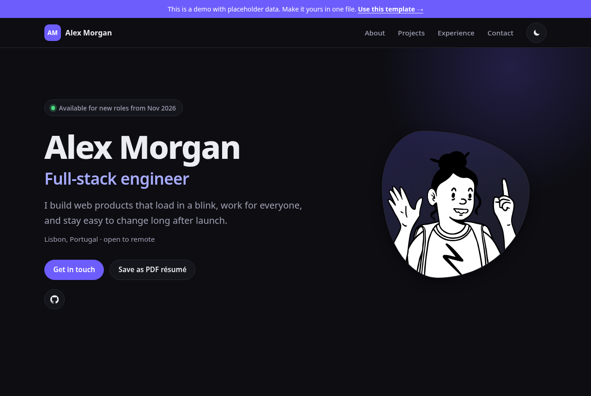
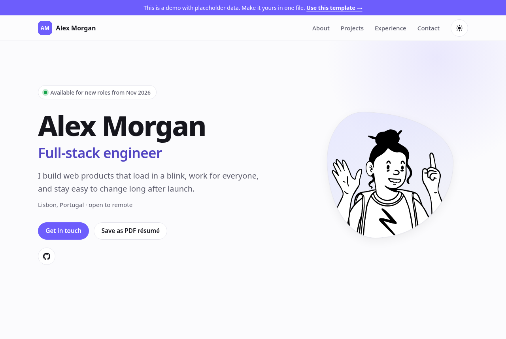

# dev-portfolio

**A fast, accessible developer portfolio you fill in from one file.** Dark and light themes,
prints as a clean résumé, deploys to GitHub Pages for free.

**[▶ See the live demo](https://qaweem321.github.io/dev-portfolio/)** (placeholder data: Alex
Morgan isn't a real person).



## Why this one

- **One file to edit.** Everything you'd change is in [`src/config.ts`](src/config.ts): name,
  projects, jobs, links, accent color. No components to dig through.
- **Mistakes are caught before they ship.** The config is checked when the site builds. A typo,
  including a misspelled field name, stops the build with a message like
  `projects.2.url: must be a full http(s):// address` instead of publishing a broken page. The
  deploy runs the type check and tests first, too.
- **No photo needed.** You get an illustrated avatar generated from any text (change the seed until
  you like it). Prefer a photo? Point it at an image.
- **Contact that always works.** Your email address is shown on the page with a Copy button
  next to it: no email app needed.
- **Prints as a résumé.** Visitors (and you) can click **Save as PDF résumé** and get a tidy
  two-page résumé: no navigation, no buttons, black on white, even from dark mode.
- **Fast.** Plain HTML and CSS with a few tiny inline scripts: about 21 KB gzipped in three
  requests (page, stylesheet, avatar), no web fonts, no trackers.
- **Accessible.** Keyboard navigation with a skip link, visible focus, labelled icon buttons,
  WCAG AA contrast in both themes, reduced-motion support, and it works without JavaScript.
- **Search-friendly.** Page description, link-preview tags and schema.org `Person` data so search
  engines show your name, role and profiles.



## Make it yours (5 minutes)

1. Click **Use this template** at the top of this page and create your repository. To use
   `https://<you>.github.io/` as the address, name it `<you>.github.io`; any other name gives
   `https://<you>.github.io/<repo-name>/`.
2. Edit **`src/config.ts`**: replace Alex with yourself. Set `templateNotice` to `null` to remove
   the "this is a demo" bar.
3. In your repository: **Settings → Pages → Source: GitHub Actions**.
4. Commit and push. The site is live a minute later.

To preview on your computer first (Node.js 22.12 or newer):

```bash
npm install
npm run dev
```

## What you can set

| Section | Fields |
| --- | --- |
| `site` | `title`, `description` (search results), `lang`, `image` (link previews), `templateNotice` |
| `person` | `name`, `role`, `tagline`, `location`, `about` (paragraphs), `availability`, `avatar`, `email`, `contactNote` (the line above it), `resumeUrl` |
| `socials` | `label`, `url`, `icon` (any [Simple Icons](https://simpleicons.org) slug, such as `github` or `mastodon`) |
| `skills` | groups of items |
| `projects` | `title`, `description`, `tags`, `url`, `repo`, `year`, `featured` |
| `experience` | `company`, `role`, `start` and `end` as `"2024-03"` (no `end` = current), `location`, `highlights` |
| `education` | `school`, `degree`, `start`, `end` |
| `theme` | `accent`: a hex color or color function, such as `#6d5dfc` or `oklch(58% 0.22 280)` |

Good to know:

- **Featured projects come first**, then the newest. The filter buttons are built from your tags.
- **Empty sections disappear** from the page and the menu, and the rest are renumbered.
- **A photo instead of the avatar:** put `me.jpg` in `public/` and set
  `avatar: { src: "/me.jpg", alt: "Your Name" }`.
- **Already have a PDF résumé?** Set `resumeUrl` and the button links to it instead of printing.
- **Dates** show as `Mar 2023`, the same in every browser and time zone.

## Commands

| Command | |
| --- | --- |
| `npm run dev` | Local preview with live reload |
| `npm run build` | Build the site into `dist/` |
| `npm run preview` | Serve the built site |
| `npm run check` | Type check, build and tests: the same checks as CI (which builds your site once; locally the tests build it again) |

## How it's tested

- **Your edits don't break them.** The detailed tests use a fixed sample config in
  [`tests/fixtures/`](tests/fixtures/portfolio.ts), so replacing the demo with yourself keeps CI and
  the deploy green. Your own config gets the general checks below.
- **The config rules:** valid and minimal configs pass; misspelled fields, bad emails, URLs, colors
  and dates, empty names, `javascript:` links and jobs that end before they start are rejected with
  the field's name.
- **The real build:** your site and the sample are built with `astro build` and the HTML is checked:
  every `#link` has a target, ids are unique, outside links open safely in a new tab, images have
  alt text, icon links have names. For the sample also: every project, job and school is on the
  page, nothing prints `undefined`, and files load from the GitHub Pages path.
- **In a browser:** both themes, phone and desktop widths, the menu, filters, keyboard focus,
  print output and color contrast were checked by hand before release.

## Hosting somewhere else

`npm run build` makes a plain static site in `dist/`: upload it to Netlify, Cloudflare Pages,
Vercel or any web server. Set the `SITE` environment variable (for example
`https://alexmorgan.dev`) for correct canonical links.

## Credits

Built with [Astro](https://astro.build). Avatar artwork: "Notionists" by Zoish (CC0), rendered by
[DiceBear](https://www.dicebear.com). Brand icons: [Simple Icons](https://simpleicons.org) (CC0).
Brand names and logos belong to their owners.

## License

MIT: use it, change it, ship it. A link back is appreciated, not required (the footer's
"Built with dev-portfolio" line is yours to keep or delete).
